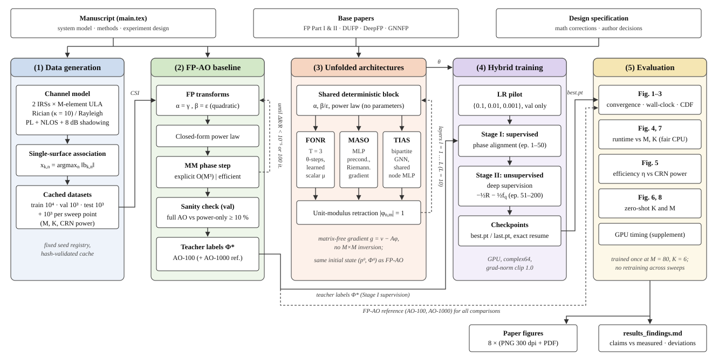

# Structural Inductive Biases in Neural Optimization: Comparative Unfolding Paradigms for Multi-IRS IoT Networks

Reproducible simulation, training and evaluation code for the paper by **Vesal Hakami** and **Payam Kouchakzade** (manuscript: [`Paper/main.tex`](Paper/main.tex)).

The repository implements, trains and benchmarks four optimisers for weighted sum-rate (WSR) maximisation in a multi-IRS uplink IoT network:

| Method | Role | Base paper | Learnable part |
|---|---|---|---|
| **FP-AO** | Model-driven baseline and teacher | Shen & Yu, *Fractional Programming for Communication Systems*, Parts I and II | none |
| **FONR** (First-Order Neural Refinement) | Learned scalar steps, nested inner loop | Xia et al., *Deep Unfolded FP-Based Beamforming in RIS-Aided MISO Systems* (DUFP) | one real step per (layer, inner step): 30 parameters |
| **MASO** (Manifold-Adaptive Step Optimization) | Learned element-wise Riemannian preconditioner | Zhu et al., *DeepFP: Deep-Unfolded Fractional Programming* | per-layer, per-IRS complex MLPs |
| **TIAS** (Topological Interference-Aware Search) | Permutation-equivariant bipartite GNN | Jiao et al., *Learning to Unfold FP … with Graph Neural Networks* (GNNFP) | one shared node MLP: 1,249 parameters |

Every figure in the paper's Numerical Results section is produced by real simulation. Nothing is tuned toward the numbers in the manuscript. An automated report compares each claim in `main.tex` with the measured result.

---

## Contents

1. [Overview flowchart](#1-overview-flowchart)
2. [Repository structure](#2-repository-structure)
3. [System model](#3-system-model)
4. [Methods](#4-methods)
5. [Training protocol](#5-training-protocol)
6. [Experiments and figures](#6-experiments-and-figures)
7. [Findings report](#7-findings-report)
8. [Reproducing the results](#8-reproducing-the-results)
9. [Deviations from the manuscript](#9-deviations-from-the-manuscript)
10. [Engineering notes](#10-engineering-notes)
11. [Publication checklist](#11-publication-checklist)
12. [References](#12-references)

---

## 1. Overview flowchart

<p align="center">
  
</p>

**Fig. 1. End-to-end pipeline of the study.**
- **(1) Data generation:** channel realisations are generated for the two-IRS uplink and associated to the IRSs, then cached.
- **(2) FP-AO baseline:** the model-driven baseline is the Lagrangian-dual plus quadratic-transform FP with an MM phase step. It is validated by the sanity check and provides the teacher labels Φ\* and the AO reference.
- **(3) Unfolded architectures:** FONR, MASO and TIAS share the deterministic FP block and differ only in the learned phase update, applied for L = 10 layers.
- **(4) Hybrid training:** an LR pilot, then supervised warm-start (Stage I), then unsupervised deep supervision (Stage II), with resumable checkpoints.
- **(5) Evaluation:** the trained models are evaluated without retraining across all sweeps. This produces the eight paper figures and the claim-by-claim findings report.

Dashed loops are iterations; the dashed long arrow carries the FP-AO reference used in every comparison. Source file: [`docs/figures/pipeline_overview.svg`](docs/figures/pipeline_overview.svg).

---

## 2. Repository structure

```
payam/
├── README.md                 this file
├── Paper/
│   ├── main.tex              manuscript (never modified by the code)
│   ├── *.png / *.pdf         generated figures (filenames referenced by main.tex)
│   └── results_findings.md   generated claim-by-claim findings report
├── Base-methods/             the five base papers (PDF)
├── docs/superpowers/
│   ├── specs/                design specification (binding math + experiment design)
│   └── plans/                implementation plan
└── code/
    ├── README.md             short developer guide
    ├── master_pipeline.ipynb the complete, resumable pipeline notebook
    ├── pytest.ini
    ├── src/                  library
    │   ├── config.py         all parameters (dataclass), seeds, config hashes
    │   ├── channels.py       geometry, path loss, fading, association
    │   ├── data.py           cached dataset builder (hash-validated)
    │   ├── fp_core.py        SINR/WSR, FP transforms, power law, matrix-free gradient
    │   ├── ao.py             FP-AO (explicit and efficient), sanity check
    │   ├── teacher.py        teacher labels + AO-1000 reference
    │   ├── models/           common.py (unfolding base), fonr.py, maso.py, tias.py
    │   ├── train.py          losses, LR pilot, resumable two-stage training, metrics
    │   ├── timing.py         device- and precision-fair latency measurement
    │   ├── experiments/      convergence.py (Fig. 1-3), sweeps.py (Fig. 4-8), cache.py
    │   ├── plotting.py       IEEE single-column figure style
    │   ├── report.py         claims registry, verdicts, deviations, report writer
    │   ├── runlog.py         pipeline.log logger (+ tqdm-safe console output)
    │   ├── atomic.py         atomic file replace with retries (Windows-safe)
    │   └── nb_helpers.py     display/orchestration helpers used by the notebook
    ├── scripts/
    │   ├── make_notebook.py  regenerates master_pipeline.ipynb
    │   ├── run_pipeline.py   executes the notebook end to end (logs to run.log)
    │   └── build_report.py   rebuilds results_findings.md from cached results
    ├── tests/                182 tests (math, models, training, resume, experiments, e2e)
    └── artifacts/            datasets, checkpoints, logs, raw results (gitignored)
```

---

## 3. System model

A single-antenna BS serves K single-antenna IoT nodes, assisted by N = 2 IRSs with M elements each (paper §II).

| Quantity | Value |
|---|---|
| Geometry (m) | BS (0, 0); user disk centred at (100, 0), radius 20; IRS₁ (10, 10), IRS₂ (10, −10) |
| Path loss | 128.1 + 37.6·log₁₀(d/1000) dB; +20 dB NLOS on direct links; 8 dB log-normal shadowing per link |
| Fading | Rician κ = 10 on user–IRS and IRS–BS links (half-wavelength ULA steering); Rayleigh on direct links |
| Noise | σ² = −90 dBm (channels normalised so that σ² = 1 internally) |
| Node classes | CRN (even k): 20 dBm, weights cycling {0.90, 0.80, 0.85}; PMN (odd k): 10 dBm, weights cycling {0.30, 0.20, 0.25} |
| Association | each user attaches to the IRS with the strongest cascaded channel ‖b_{k,n}‖ |
| Defaults | M = 80, K = 6 (training), L = 10 layers |

Effective channel: H_k = h_{d,k} + Σ_n x_{k,n} b_{k,n}ᴴ φ_n, with b_{k,n} = diag(g_n) h*_{r,k,n} and |φ_{n,m}| = 1.
Objective: R = Σ_k w_k log₂(1 + γ_k), subject to 0 ≤ p_k ≤ P_k^peak.

---

## 4. Methods

All four methods share the same deterministic block, which follows the order of `main.tex` Algorithm 1.

1. **Lagrangian dual transform:** α_k = γ_k and w̃_k = w_k(1 + α_k).
2. **Quadratic transform:** β_k = ε_k = √(w̃_k p_k) H_k / D, with Ξ = Σ|ε_k|².
3. **Closed-form power law** (Shen–Yu Part I, eq. 44): p_k ← min{P_k, w̃_k (Re{β_k*H_k})² / (|H_k|² Σ|β_i|²)²}.

They differ only in the phase update. That update maximises the per-IRS quadratic surrogate f₃(φ_n) = 2Re{v_nᴴφ_n} − φ_nᴴA_nφ_n, whose gradient is g_n = v_n − A_nφ_n. The gradient is computed matrix-free as g_n = Σ_k x_{k,n} c_k b_{k,n}.

| Method | Phase update | Cost per iteration or layer |
|---|---|---|
| **FP-AO** | Majorisation–minimisation, the exact non-homogeneous bound of DeepFP Lemma 1: φ_n ← exp(j∠(v_n + (λ_max I − A_n)φ_n)). Explicit form builds A_n and runs an M×M eigen-decomposition; efficient form uses the K_n×K_n Gram matrix. Iterates are identical. | explicit O(KM² + M³); efficient O(K²M + K³) |
| **FONR** | T = 3 inner projected-gradient steps on θ: θ ← θ + μ_{l,t}·2Re{−j φ* ⊙ g} (DUFP) | O(T·K·M) |
| **MASO** | Riemannian gradient r = g − Re{g ⊙ φ*}φ, step vector λ = c·Softplus(Ψ_{l,n}([φ, ĝ])), retraction φ ← (φ + λ⊙r)/\|φ + λ⊙r\| (DeepFP) | O(K·M + M²) |
| **TIAS** | Messages u¹ = Σ x b c = g and u² = Σ x Ξ p\|b\|² = diag(A); shared MLP on scale-free node features gives a step s; Jacobi update φ ← normalise(φ + s·u¹/u²) | O(\|E\|) |

**Size handling.**
- FONR and TIAS have no parameters tied to M or K, so they run at any size.
- MASO's MLP has a fixed input of 2·80. For other array sizes it zero-pads when M < 80 and truncates when M > 80, leaving the tail elements unchanged. This is the zero-shot protocol of `main.tex` §VI.

---

## 5. Training protocol

`main.tex` §V, applied identically to FONR, MASO and TIAS.

| Item | Setting |
|---|---|
| Teacher | FP-AO run to ΔR/R < 10⁻⁵ or 100 iterations (Table I), from the same initial state as the networks |
| LR pilot | Adam lr ∈ {0.1, 0.01, 0.001}; 5 supervised + 15 unsupervised epochs; chosen on validation WSR only |
| Stage I (epochs 1–50) | Phase alignment: (1/NM) Σ (1 − Re{φ^{(L)} φ*^*}) |
| Stage II (epochs 51–200) | Deep supervision Σ_l (l/55)·[−0.5·R_nats − 0.5·f_q], where f_q is the Shen–Yu lower bound of the ln-WSR (α detached) |
| Batch / optimiser | 200; Adam with a constant lr; gradient-norm clipping at 1.0; batches with non-finite gradients are skipped and counted |
| Precision | complex64 training on GPU; complex128 for evaluation, AO and paper timing |
| Selection | `best.pt` is chosen by validation WSR. The test set is used once, after training. |

**Why the loss is negative.** The loss is −(objective), so it is negative by construction. The logs record the WSR term and the f_q term separately.

**Checkpoints and resume.**
- Each model writes `{model}_last.pt` every epoch and `{model}_best.pt` on a new best.
- Each checkpoint holds the model, optimiser and random-number state, the metrics history and a config hash.
- Re-running resumes exactly where it stopped. A changed configuration is refused, so old and new runs are never mixed.
- Datasets, teacher labels, LR pilots and every experiment point are fingerprint-cached in the same way.

---

## 6. Experiments and figures

The models are trained once, at M = 80, K = 6 and CRN power 20 dBm. Every sweep evaluates them **without retraining**. Each sweep point has its own 10³-sample test set.

| Fig. | Output file (`Paper/`) | Experiment | Metric |
|---|---|---|---|
| 1 | `WSR_vs_iteration` | Default test set, AO iteration or network layer 0…10 | Mean WSR ± 95 % CI; dashed lines for AO converged and AO-1000 |
| 2 | `WSR_vs_wall_clock` | Same runs, cumulative CPU time | Mean WSR vs time, both AO implementations |
| 3 | `CDF` | ΔR = R_AO − R_method at L = 10 | Empirical CDF; 95th percentile and left tail |
| 4 | `avg_time_vs_Number_of_RIS_M` | M ∈ {20, 40, …, 180} | Per-iteration or per-layer time, log scale |
| 5 | `etha_vs_CRN_transmit_power` | CRN ∈ {20, …, 45} dBm, PMN = CRN − 10 dB | η = mean R_method / mean R_AO × 100 % |
| 6 | `WSR_vs_Number_of_active_users_K` | K ∈ {10, 15, …, 60} (zero-shot) | Mean WSR |
| 7 | `avg_time_vs_Number_of_active_users_K` | Same K sweep | Per-iteration or per-layer time |
| 8 | `WSR_vs_M_ZeroShot` | M ∈ {20, 40, 60, 80, 100, 120, 160} (zero-shot) | Mean WSR |

Every figure is saved as a 300-dpi PNG plus a PDF, at IEEE single-column width.

**Fair timing (Figs. 2, 4, 7).**
- Every method runs on the CPU, in complex128, one sample at a time, in eager PyTorch, with a fixed thread count and warm-up runs discarded.
- All methods are timed on the same subset of samples (by default the first 200).
- Each timed step includes all the work the method really does: AO includes building A_n and the eigenvalue computation, and the networks include the deterministic block.
- Both FP-AO implementations are shown.
- A supplementary GPU timing table (complex64) appears in the report.

---

## 7. Findings report

`Paper/results_findings.md` is generated from the cached results.

- **Claims table:** about 60 claims from §VI of `main.tex`, each with an explicit tolerance taken from the claim's own wording. Each gets one of: Confirmed, Partly confirmed, Contradicted, Not run, or Error. A direction tag (above or below the claim, sign inverted) makes a result such as "the network beats AO" visible instead of hidden.
- **Deviations list:** every place the code departs from the manuscript, with the reason and evidence (see §9).
- **Supporting tables:** training, validation and test metrics; CPU vs GPU latency; LR pilot outcomes; efficiency as both ratio of means and mean of ratios; provenance (config hashes and the AO baseline used).
- **Text suggestions:** concrete edits for §III, §IV and §VI. They are never applied automatically.

---

## 8. Reproducing the results

**Environment.** Python 3.13 with PyTorch 2.8 + CUDA 12.6, NumPy, SciPy, Matplotlib, Pandas, tqdm and nbconvert, all in `E:\payam\env`. The development machine has a GTX 1660 Ti (6 GB).

Run every command from `E:\payam\code`.

**1. Verify the code**

```bash
E:/payam/env/Scripts/python.exe -m pytest
```

**2. Run the full pipeline.** This builds data and labels, trains the three networks, runs all experiments, and writes the figures and report. It is resumable.

```bash
E:/payam/env/Scripts/python.exe -m nbconvert --to notebook --execute --inplace --ExecutePreprocessor.timeout=-1 master_pipeline.ipynb > run.log 2>&1
```

You can also run `scripts/run_pipeline.py`. Progress is written to `artifacts/logs/pipeline.log` and shown with tqdm bars. Keep the machine idle during the timing sections.

**3. Options** (configuration cell of the notebook)

| Option | Default | Meaning |
|---|---|---|
| `AO_MAX_ITER` | 100 | FP-AO cap (Table I). Any other value, e.g. 1000, makes that AO the baseline and the teacher, in a separate `artifacts_ao{N}/` tree. |
| `TIMING_SUBSET` | 200 | Number of samples timed; `None` times all 1000, which is much slower |
| `RESUME` / `FORCE_RETRAIN` / `FORCE_RERUN` | True / False / False | Resume and recompute controls |

**4. Rebuild only the report** from cached results:

```bash
E:/payam/env/Scripts/python.exe scripts/build_report.py
```

**Reproducibility guarantees.**
- Fixed seed registry: train, val, test and every sweep point use distinct seeds.
- Every cache is hash- and fingerprint-validated.
- Resume is bit-exact.
- `main.tex` is never modified.

---

## 9. Deviations from the manuscript

The code uses the mathematically correct form from the base papers. Wherever `main.tex` is wrong or incomplete, the code keeps the paper's experiment design. Main points:

| Topic | `main.tex` | Implemented | Reason |
|---|---|---|---|
| Excitation vector v_n | uses h*_{d,i} | uses h_{d,i} | Expanding \|h_d + bᴴφ\|² gives h_d, not its conjugate |
| Transform logarithm | log₂ | natural log inside the transforms (WSR still reported in bits) | α* = γ holds only for the natural log |
| AO phase step | A_n⁻¹v_n, then projection | MM step from DeepFP Lemma 1 (authors' decision) | A_n has rank ≤ K_n ≪ M, so it has no inverse |
| AO cost | always cubic | explicit (cubic) and efficient (Gram) forms, both timed | Same iterates, very different cost; both are reported honestly |
| TIAS message | [b·c, \|b\|²] | [b·c, Ξ·p·\|b\|²] | Equals diag(A_n) exactly |
| FONR operator | complex scalar weight | real step on θ (DUFP) | Matches the base paper and `main.tex`'s own angle parameterisation |
| MASO input | per-user channels (§IV) or aggregates (§VI) | [φ, normalised gradient] (DeepFP) | Resolves the paper's internal contradiction; K-agnostic |
| Test-set size | 80 / 200 / 10³ | 10³ everywhere | Table I value |
| Geometry | not specified | §3 above, frozen after the validation sanity check | Needed for reproducibility |

The full list, with build-time evidence, is in the generated report. It also covers:
- the AO 100-iteration under-convergence and the AO-1000 reference;
- the MASO step scale and the FONR initial-step probe;
- gradient clipping;
- the observation that, in Algorithm 1's order, only users at peak power drive the phase update;
- the observation that FP-AO usually converges to a single active user.

**Build-time observations the authors should know before reading the figures.**
- **Sanity check (val):** full FP-AO gains 79.7 % over power-only optimisation, so the IRS matters.
- **AO under-converges:** with the Table I cap of 100 iterations, about 55 % of samples hit the cap. Mean test WSR is 4.02 bits at 100 iterations against 4.27 bits at 1000.
- **Untrained networks already beat the AO baseline** on validation:

  | Method | Mean val WSR (bits) |
  |---|---|
  | FP-AO, 100 iterations | 3.98 |
  | FP-AO, 1000 iterations | 4.24 |
  | TIAS, untrained, 10 layers | 4.36 |
  | MASO, untrained, 10 layers | 4.31 |

  The MM step is valid but conservative. Whether to report the AO baseline at 100 or 1000 iterations is an open decision for the authors.

---

## 10. Engineering notes

- **PyTorch CPU bug.** In torch 2.8 on CPU with several threads, batched complex `matmul`/`einsum` with a single-row left operand returns wrong results. The code uses broadcast multiply-and-sum everywhere this could occur, and a regression test guards it.
- **Speed.** Training uses a CUDA-graph step with one host sync per batch, about 5–10× faster per epoch than eager mode. If graph capture fails, training falls back to eager mode and writes a warning to `pipeline.log`.
- **Numerical safety.**
  - SINR is computed from masked interference, avoiding cancellation in complex64.
  - The square root has a finite gradient at zero power.
  - TIAS feature statistics are detached and floored.
  - Every file write is atomic, with retries for Windows file locks.
- **GPU supplement.** FP-AO run to convergence is numerically unstable in complex64 on the GPU, so the report marks it "not available" and shows the failure rate, instead of averaging over the samples that survived.

---

## 11. Publication checklist

- [ ] Run the full pipeline (§8) and archive `run.log` and `artifacts/logs/`.
- [ ] Decide the AO baseline (100 vs 1000 iterations). If it changes, re-run with `AO_MAX_ITER = 1000`.
- [ ] Read `Paper/results_findings.md` and resolve every Contradicted or Partly confirmed claim.
- [ ] Update `main.tex` §III (math corrections, MM phase step, explicit vs efficient AO complexity).
- [ ] Update `main.tex` §IV (FONR, MASO and TIAS formulations as implemented; TIAS message).
- [ ] Update `main.tex` §VI (numbers, figure captions, test-set size 10³, geometry, timing method).
- [ ] Recompile `main.tex` against the generated `Paper/*.png` and check every figure.
- [ ] Add a "Code availability" statement; archive this repository, e.g. on Zenodo with a DOI.
- [ ] Record the software environment (`pip freeze` of `env`) and the hardware used for timing.

---

## 12. References

1. K. Shen and W. Yu, "Fractional Programming for Communication Systems—Part I: Power Control and Beamforming," *IEEE Trans. Signal Process.*, vol. 66, no. 10, pp. 2616–2630, 2018.
2. K. Shen and W. Yu, "Fractional Programming for Communication Systems—Part II: Uplink Scheduling via Matching," *IEEE Trans. Signal Process.*, vol. 66, no. 10, pp. 2631–2644, 2018.
3. W. Xia, Y. Jiang, B. Zhao, H. Zhao, and H. Zhu, "Deep Unfolded Fractional Programming-Based Beamforming in RIS-Aided MISO Systems," *IEEE Wireless Commun. Lett.*, vol. 13, no. 2, pp. 515–519, 2024.
4. J. Zhu, T.-H. Chang, L. Xiang, and K. Shen, "DeepFP: Deep-Unfolded Fractional Programming for MIMO Beamforming," *IEEE Trans. Commun.*, 2026 (arXiv:2601.02822). Code: https://github.com/zhujhz/DeepFP
5. Z. Jiao, X. Yi, and S. Jin, "Learning to Unfold Fractional Programming for Multi-Cell MU-MIMO Beamforming with Graph Neural Networks," arXiv:2601.07630, 2026.
